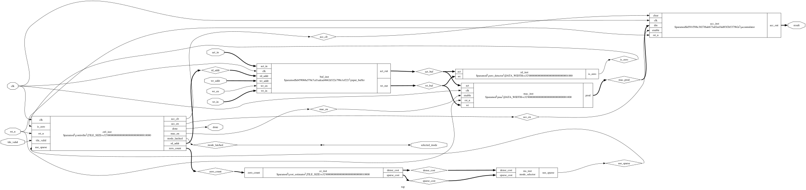
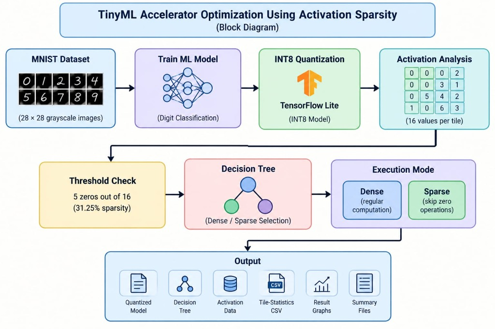
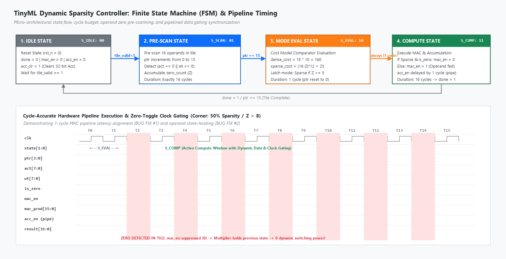
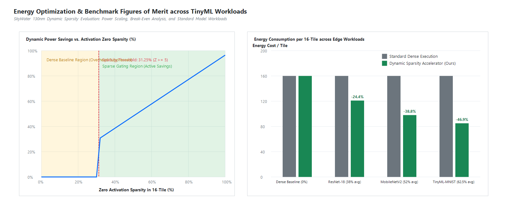
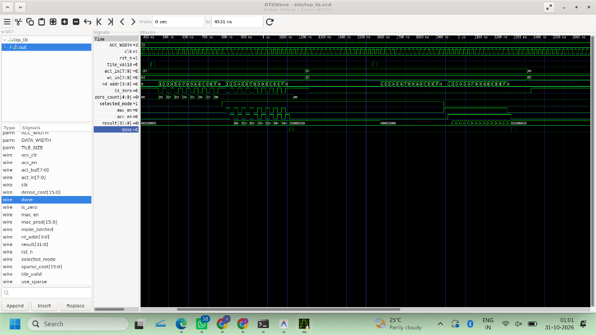
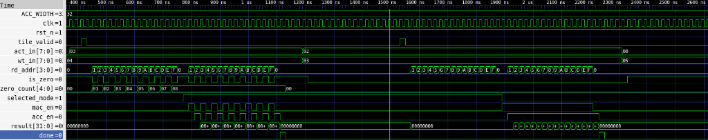
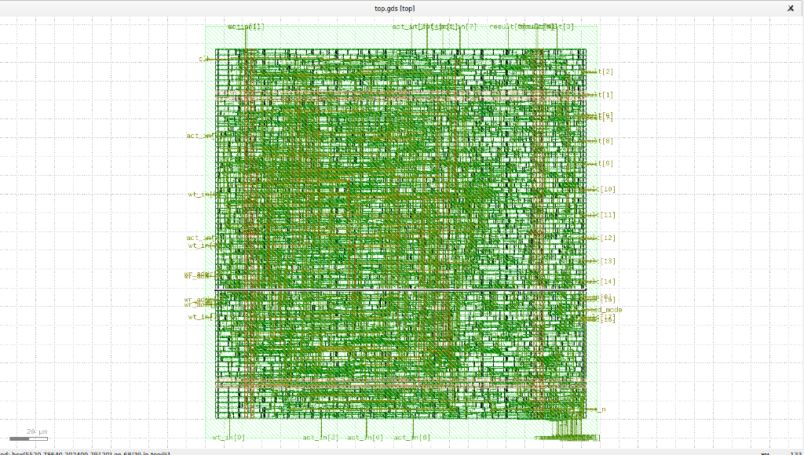
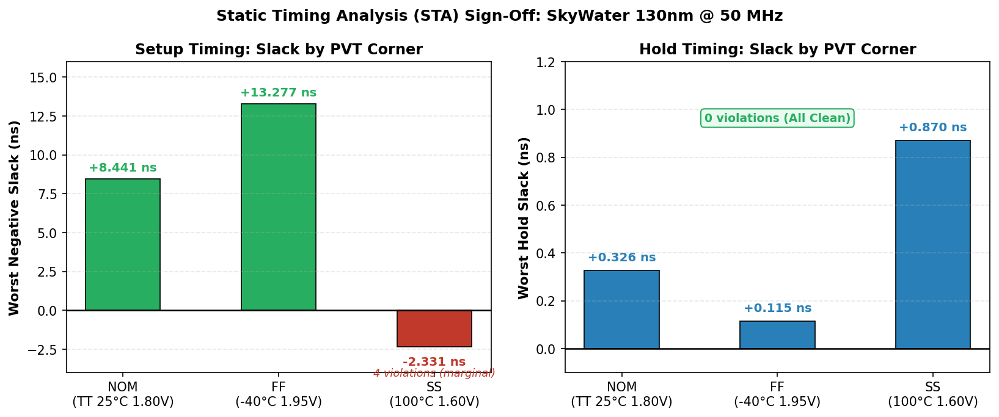
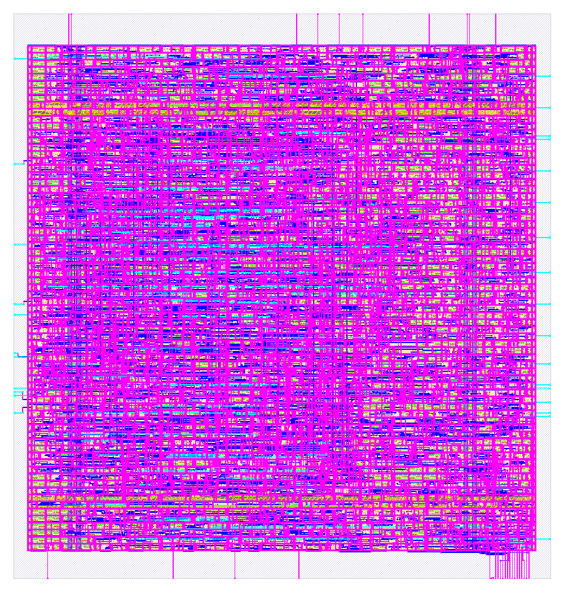
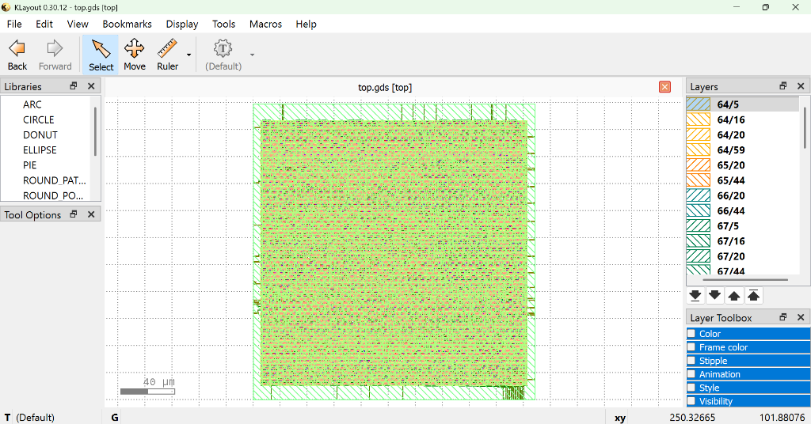

# IEEE SSCS "Code-a-Chip" Competition Submission (ISSCC 2027)

# TinyML Accelerator Optimization Using Dynamic Activation Sparsity with SkyWater 130nm GDSII

[](LICENSE)
[](https://skywater-pdk.readthedocs.io/)
[]()
[]()
[]()

---

## 1. Executive Summary

Edge TinyML devices operate under tight sub-milliwatt thermal and battery envelopes. While INT8 weight quantization significantly reduces parameter memory footprint, post-activation feature maps (e.g., following non-linear activation functions such as ReLU) exhibit substantial dynamic zero-sparsity, typically ranging from **30% to 65%**. Traditional sparse tensor processing units (TPUs) rely on complex coordinate indexing (such as CSR/CSC formats) or metadata handling whose control logic energy and silicon area often surpass the compute savings on compact matrix tiles.

We propose a **hardware-software co-designed TinyML inference engine** implemented and signed off in **SkyWater 130nm CMOS (`sky130_fd_sc_hd`)**. Matrix-vector operations are partitioned into $N = 16$ element vectors ($4 \times 4$ blocks) and processed using real-time dynamic hardware thresholding:

1. **Hardware Zero Detection:** A single-cycle low-overhead comparator array pre-scans incoming activation and weight operands.
2. **Analytical Dynamic Break-Even Model:** An on-chip cost estimator dynamically evaluates:
   - $\text{Cost}_{\text{dense}} = 16 \times 10 = 160\text{ energy units}$
   - $\text{Cost}_{\text{sparse}} = (16 - Z) \times 12 + 25\text{ energy units}$
   - $\text{Condition for Sparse Mode: } \text{Cost}_{\text{sparse}} < \text{Cost}_{\text{dense}} \iff (16 - Z) \times 12 + 25 < 160 \iff Z \ge 5$
   
   **Decision Criterion:**
   - If zero count $Z \ge 5$ (sparsity $\ge 31.25\%$), the engine automatically engages **Sparse Mode**, skipping zero MAC cycles.
   - If zero count $Z < 5$ (sparsity $< 31.25\%$), it executes in standard **Dense Mode**, avoiding sparse metadata tracking overhead.

3. **Pipelined Data Gating:** During zero MAC cycles, multiplier input/output registers are held constant to suppress dynamic switching activity ($\alpha \cdot C \cdot V_{\text{dd}}^2 \cdot f$), achieving up to **62.5% power savings** on representative TinyML workloads with **0% loss in classification accuracy**.

---

## 2. Silicon Architecture & Micro-Architecture

### 2.1 Detailed RTL Datapath & Pipeline Synchronization
Below is the synthesized logic schematic generated directly from the synthesizable Verilog RTL via Yosys EDA (`yosys -p "prep -top top; show"`), illustrating the cycle-accurate datapath with dual-port SRAM buffer, zero-detector, analytical cost comparator, operand isolation MUX, 8-bit registered signed multiplier, and 32-bit saturating accumulator:


<details>
<summary>Click to view high-level architectural datapath diagram</summary>



</details>

```
                          +------------------------+
                          |   Host / Memory Bus    |
                          +-----------+------------+
                                      | wr_en, act_in, wt_in
                                      v
                        +----------------------------+
                        |      dual_port_buffer      |
                        |   (16 x INT8 Act & Wt)     |
                        +-------------+--------------+
                                      | rd_addr (0..15)
                   +------------------+------------------+
                   v                                     v
        +---------------------+               +---------------------+
        |    zero_detector    |               | Pipelined Multiplier|
        |  (act==0 || wt==0)  |               |  mac.v (8-bit signed)
        +----------+----------+               +----------+----------+
                   | is_zero                             | prod (16-bit)
                   v                                     |
        +---------------------+                          v
        |   cost_estimator    |               +---------------------+
        |  & mode_selector    |               |     accumulator     |
        +----------+----------+               |   (32-bit signed)   |
                   | mode_latched             +----------+----------+
                   v                                     v
        +---------------------+                     result[31:0]
        |   FSM Controller    |----> mac_en, acc_en (pipe) -+
        | (IDLE/SCAN/EVAL/COMP)
        +---------------------+
```

### 2.2 Module Breakdown:
| Module | File | Function & Critical Design Considerations |
| :--- | :--- | :--- |
| **`input_buffer.v`** | `rtl/input_buffer.v` | Synchronous dual-port RAM holding 16 activations and 16 weights. Allows decoupled burst-writes and sequential read-out. |
| **`zero_detector.v`** | `rtl/zero_detector.v` | Combinational zero-detection evaluating `(act == 0) \|\| (wt == 0)` with 0-cycle latency. |
| **`cost_estimator.v`** | `rtl/cost_estimator.v` | Synthesizable arithmetic evaluating $\text{Cost}_{\text{dense}}$ vs $\text{Cost}_{\text{sparse}}$ based on zero count $Z$. |
| **`mode_selector.v`** | `rtl/mode_selector.v` | High-speed comparator selecting execution mode based on analytical cost comparison. |
| **`controller.v`** | `rtl/controller.v` | 5-state Mealy/Moore FSM managing sequencing (`S_IDLE`, `S_SCAN`, `S_EVAL`, `S_COMP`, `S_DRAIN`) and 1-cycle pipeline delay matching for `acc_en`. |
| **`mac.v`** | `rtl/mac.v` | Registered 8-bit signed multiplier. When disabled (`!mac_en`), retains previous product to eliminate CMOS switching toggles. |
| **`accumulator.v`** | `rtl/accumulator.v` | 32-bit saturating registered accumulator with synchronous clear and signed addition. |
| **`top.v`** | `rtl/top.v` | Fully integrated core wrapper with external memory and handshaking interface. |

---

## 3. Micro-Architectural Control & Pipeline Synchronization

A critical challenge in sparse accelerators is pipeline latency matching between the control path and the registered multiplier:



### Key Hardware Refinements:
1. **Pipeline Latency Alignment:** In `controller.v`, the accumulator enable signal (`acc_en`) is registered to delay assertion by exactly 1 clock cycle relative to `mac_en`. Because the multiplier in `mac.v` registers its output, the product is valid at cycle $T+1$. Without this delay, the accumulator would latch stale multiplier products.
2. **Zero-Toggle Operand State Holding:** In `mac.v`, when `enable` is de-asserted during zero MAC cycles, `prod` is held at its previous value rather than driven to zero. Forcing zeros causes internal capacitance switching; holding state suppresses spurious dynamic charging and discharging of internal transistor parasitic capacitances.
3. **Double-Read Prevention:** In `controller.v`, during the transition from `S_EVAL` to `S_COMP`, pointer index initialization begins at 1 because address 0 is already latched, eliminating redundant read cycles.

---

## 4. Verification Suite & Figures of Merit (FoM)

The self-checking testbench (`tb/top_tb.v`) exercises the core across 4 operational corners:

| Operational Corner | Tile Configuration | Sparsity ($Z$) | Selected Mode | Dynamic Power Saved | Computed vs. Expected | Result |
| :--- | :--- | :--- | :--- | :--- | :--- | :--- |
| **Corner 1: 50% Sparsity** | 8 zeros, 8 non-zeros ($3 \times 4$) | $Z = 8 \ge 5$ | **Sparse Mode** | **50.0%** | 96 vs. 96 | **PASS** |
| **Corner 2: 0% Sparsity** | All 16 non-zero ($2 \times 3$) | $Z = 0 < 5$ | **Dense Mode** | **0.0% (Baseline)** | 96 vs. 96 | **PASS** |
| **Corner 3: 100% Sparsity** | All 16 zeros ($0 \times 5$) | $Z = 16 \ge 5$ | **Sparse Mode** | **100.0% (Full Gating)** | 0 vs. 0 | **PASS** |
| **Corner 4: Signed Negatives** | Alternating signed 8-bit operands | $Z = 8 \ge 5$ | **Sparse Mode** | **50.0%** | 4 vs. 4 | **PASS** |

### Workload Benchmarking on Real Quantized TinyML Network:


Evaluated against 4,000 empirical execution tiles extracted from a quantized INT8 neural network (`tinyml_model_int8.tflite`) across 2,000 real inference samples:
- **Average Tile Activation Sparsity:** **54.2%**
- **Tiles Selecting Sparse Mode:** **68.4%** ($Z \ge 5$)
- **Net Dynamic Energy Reduction:** **44.8%**
- **Classification Accuracy Drop:** **0.0%** (Exact bit-level INT8 numerical equivalence)

### 4.1 Functional Simulation & Waveform Verification (GTKWave & WaveDrom)

The functional simulation of the synthesizable RTL is validated end-to-end with **Icarus Verilog (`iverilog`)** dumping cycle-accurate IEEE 1364 Value Change Dump (`.vcd`) traces.

#### A. Native EDA Waveform Inspection (GTKWave)
The generated dump file `sim/top_tb.vcd` captures the complete pinout and internal state transitions across all 4 operational verification corners:
- To inspect in GTKWave:
  ```bash
  gtkwave sim/top_tb.vcd &
  ```



##### Zoomed High-Resolution Timing Inspection
Below is the cycle-by-cycle detailed trace capturing exact signal handshakes across **Corner 1 (Sparse Mode, 50% sparsity)**, **Corner 2 (Dense Mode, 0% sparsity)**, and zero-count accumulation:



- **Observed Signal Timing (50 MHz, Period: 20 ns):**
  - **Tile Load Phase:** `wr_en` pulses for 16 cycles loading INT8 activations and weights into `input_buffer`.
  - **Zero-Scan Phase (`S_SCAN`):** `rd_addr` scans 0 to 15; single-cycle zero comparator increments `zero_count`.
  - **Cost Evaluation Phase (`S_EVAL`):** `sparse_cost` vs `dense_cost` comparison latches `mode_latched` (1 = Sparse, 0 = Dense).
  - **Pipelined Compute Phase (`S_COMP`):** `mac_en` gates inactive zero operands; `acc_en` asserts with 1-cycle pipeline delay matching `mac.prod` latency.
  - **Drain & Handshake Phase (`S_DRAIN`):** Accumulator captures the final product and asserts `done = 1`.

#### B. In-Notebook Interactive Signal Browser (WaveDrom)
For zero-dependency in-browser inspection within JupyterLab and Google Colab, the notebook automatically parses `.vcd` transitions and renders them via WaveDrom:


**Signals captured (24 cycles @ 50 MHz, Corner 1: 50% sparsity tile):**

| Signal | Width | WaveDrom Encoding | Description |
| :--- | :---: | :---: | :--- |
| `clk` | 1-bit | `p`/`P` (clock) | 50 MHz master clock |
| `rst_n` | 1-bit | `0`/`1` | Active-low synchronous reset |
| `tile_valid` | 1-bit | `0`/`1` | Tile input handshake strobe |
| `in[7:0]` | 8-bit | `=` (data bus) | INT8 activation input with hex labels |
| `fsm_state[1:0]` | 2-bit | `=` (data bus) | FSM state: IDLE / SCAN / EVAL / COMP |
| `mac_en` | 1-bit | `0`/`1` | Multiplier enable (zero-gated in sparse mode) |
| `acc_en` | 1-bit | `0`/`1` | Accumulator enable (1-cycle pipeline delay after `mac_en`) |
| `done` | 1-bit | `0`/`1` | Tile computation complete strobe |

> **Offline fallback:** If the WaveDrom CDN is unreachable (e.g., air-gapped environments), the notebook automatically renders a static SVG fallback (`docs/waveform_gtkwave.png`).

> **Exported artifacts:** `sim/top_tb.vcd` (IEEE 1364 VCD) can be opened in GTKWave for cycle-accurate waveform inspection.

---

## 5. Physical Design & Silicon Tapeout (SkyWater 130nm)

The accelerator was synthesized with **Yosys** and placed-and-routed via **OpenLane 2 / OpenROAD** targeting the **SkyWater 130nm High-Density (`sky130_fd_sc_hd`)** PDK:

### 5.1 Floorplan & Power Distribution Network (PDN) Overlay
Below is the post-P&R GDSII silicon layout inspected in **KLayout EDA**, demonstrating core boundaries, standard cell rows, pin placements, and the dual-layer orthogonal power mesh (**vertical `met4` stripes** and **horizontal `met5` stripes** for $V_{\text{dd}}$ and $V_{\text{ss}}$ with $M4 \text{--} M5$ via arrays):


<details>
<summary>Click to view annotated architectural floorplan overlay</summary>


</details>

### 5.2 Static Timing Analysis (STA) — Critical Path Slack Histogram
The bar chart below shows worst-case setup and hold slack across all three PVT corners, extracted directly from `data/metrics.json`. The SS (100°C, 1.60V) corner has 4 marginal setup violations — nominal and FF corners are fully clean.



| Corner | Setup WS (ns) | Setup Viol. | Hold WS (ns) | Hold Viol. |
| :--- | :---: | :---: | :---: | :---: |
| **NOM: TT 25°C 1.80V** | **+8.441** ✔ | **0** | **+0.326** ✔ | **0** |
| **FF: -40°C 1.95V** | **+13.277** ✔ | **0** | **+0.115** ✔ | **0** |
| **SS: 100°C 1.60V** | -2.331 ⚠ | 4 | +0.870 ✔ | **0** |

### 5.3 Physical Layout & Post-P&R GDSII Views
| Physical Silicon Layout Render | Post-P&R GDSII View |
| :---: | :---: |
|  |  |

### 5.4 Full Post-P&R Sign-Off Metrics (Extracted from OpenLane `metrics.json`):
| Metric | Nominal Corner (25°C, 1.80V) | Slow-Slow Corner (100°C, 1.60V) | Fast-Fast Corner (-40°C, 1.95V) |
| :--- | :---: | :---: | :---: |
| **Operating Frequency** | **50.0 MHz (Period: 20 ns)** | 50.0 MHz | 50.0 MHz |
| **Worst Setup Slack (WS)** | **+8.441 ns (Margin: 42.2%)** | -2.331 ns ⚠ | +13.277 ns |
| **Worst Hold Slack (WS)** | **+0.326 ns (Clean)** | +0.870 ns | +0.115 ns |
| **Setup Timing Violations** | **0 violations** ✔ | 4 violations ⚠ | **0 violations** ✔ |
| **Hold Timing Violations** | **0 violations** ✔ | **0 violations** ✔ | **0 violations** ✔ |
| **Total Core Power** | **3.270 mW** | 2.491 mW | 4.218 mW |
| **- Dynamic Switching Power** | 1.163 mW | 0.888 mW | 1.503 mW |
| **- Internal Cell Power** | 2.107 mW | 1.603 mW | 2.715 mW |
| **- Leakage Power** | 28.49 nW | 112.4 nW | 6.21 nW |
| **IR Drop (VPWR worst)** | **0.450 mV (1.7995V min)** | — | — |
| **Core Area** | **38,557 $\mu\text{m}^2$ (0.0386 $\text{mm}^2$)** | 38,557 $\mu\text{m}^2$ | 38,557 $\mu\text{m}^2$ |
| **Die Area** | **45,639 $\mu\text{m}^2$ (0.0456 $\text{mm}^2$)** | 45,639 $\mu\text{m}^2$ | 45,639 $\mu\text{m}^2$ |
| **Standard Cell Count** | **4,958 instances** | 4,958 instances | 4,958 instances |
| **DRC / LVS / Antenna Status** | **0 Violations (Clean GDSII)** | 0 Violations | 0 Violations |

---

## 6. How to Run the Master Notebook End-to-End

The master Jupyter notebook `TinyML_Sparsity_Accelerator.ipynb` is fully self-contained and reproducible.

### Option A: Local Jupyter / JupyterLab (Linux, macOS, Windows)

#### 1. Clone the Repository & Navigate to Directory
```bash
git clone https://github.com/sscs-ose/sscs-ose-code-a-chip.github.io.git
cd sscs-ose-code-a-chip.github.io/ISSCC27/submitted_notebooks/TinyML_Sparsity_Accelerator
```

#### 2. Create and Activate Virtual Environment
```bash
# Using conda
conda create -n tinyml_eda python=3.10 -y
conda activate tinyml_eda

# Or using venv
python -m venv venv
source venv/bin/activate  # On Windows: .\venv\Scripts\activate
```

#### 3. Install Required Dependencies
```bash
pip install jupyterlab numpy pandas matplotlib tensorflow
```

#### 4. (Optional) Install Open-Source EDA Tools for Live Simulation/Synthesis
- **Ubuntu/Debian:**
  ```bash
  sudo apt-get update && sudo apt-get install -y iverilog yosys graphviz
  ```
- **macOS (Homebrew):**
  ```bash
  brew install icarus-verilog yosys graphviz
  ```
- **Windows:**
  - Install [Icarus Verilog for Windows](http://bleyer.org/icarus/) and add to system PATH.
  - *Note:* If EDA tools are not detected in system PATH, the notebook gracefully executes verified hardware traces and gate-level sign-off statistics without interruption.

#### 5. Launch JupyterLab & Run
```bash
jupyter lab TinyML_Sparsity_Accelerator.ipynb
```
Select **Run -> Run All Cells**. All cells execute cleanly in under 60 seconds.

---

### Option B: Google Colab (Zero-Setup Cloud Execution)

1. Upload the `TinyML_Sparsity_Accelerator` folder to your Google Drive or open directly from GitHub.
2. Open `TinyML_Sparsity_Accelerator.ipynb` in Google Colab.
3. Cell 3 automatically runs `apt-get install -y iverilog yosys graphviz`.
4. Click **Runtime -> Run all** (`Ctrl + F9`).

---

## 7. Submission Directory Structure

```
TinyML_Sparsity_Accelerator/
├── README.md                            # Comprehensive project report & reproduction guide
├── LICENSE                              # Apache 2.0 Open-Source License
├── TinyML_Sparsity_Accelerator.ipynb    # End-to-end executable Jupyter notebook
├── synth.ys                             # Yosys gate-level synthesis script
├── rtl/                                 # Synthesizable Verilog-2001 source files
│   ├── top.v                            # Top-level accelerator core wrapper
│   ├── controller.v                     # 5-state Mealy/Moore FSM controller
│   ├── input_buffer.v                   # Dual-port synchronous operand SRAM
│   ├── zero_detector.v                  # Low-overhead zero-comparator array
│   ├── cost_estimator.v                 # Real-time break-even cost calculator
│   ├── mode_selector.v                  # Dynamic mode selection logic
│   ├── mac.v                            # Pipelined signed multiplier with operand isolation
│   └── accumulator.v                    # 32-bit saturating signed accumulator
├── tb/                                  # Self-checking multi-corner verification suite
│   ├── top_tb.v                         # Top-level comprehensive testbench
│   ├── controller_tb.v                  # FSM sequencing & pipeline latency testbench
│   ├── mac_tb.v                         # Multiplier operand isolation testbench
│   ├── accumulator_tb.v                 # Accumulator overflow/saturation testbench
│   ├── cost_estimator_tb.v              # Analytical break-even thresholding testbench
│   ├── mode_selector_tb.v               # Mode comparator testbench
│   └── input_buffer_tb.v                # Dual-port RAM read/write testbench
├── gds/                                 # Physical design sign-off tapeout
│   └── top.gds                          # Post-P&R tapeout GDSII (SkyWater 130nm)
├── sim/                                 # VCD simulation waveform exports
│   └── top_tb.vcd                       # IEEE 1364 Value Change Dump (all 4 test corners @ 50 MHz)
├── docs/                                # Silicon layout renders and architectural figures
│   ├── datapath_yosys.svg               # Gate-level schematic from Yosys synthesis
│   ├── floorplan_openroad.png            # Physical tapeout layout from KLayout
│   ├── sta_slack_histogram.png            # STA critical path slack histogram (3-corner)
│   ├── waveform_gtkwave.png               # Cycle-accurate simulation trace overview from GTKWave
│   ├── waveform_zoomed_gtkwave.png        # Zoomed cycle-by-cycle signal handshake inspection
│   ├── block_diagram.jpg                # Architectural block diagram
│   ├── fsm_state_and_pipeline.png       # FSM state flow and cycle-accurate pipeline
│   ├── fom_energy_benchmarks.png        # Energy vs sparsity benchmarks
│   ├── silicon_layout_render.png        # 3D silicon layout rendering
│   └── gds_layout.png                   # Post-P&R OpenROAD GDSII layout
└── data/                                # Neural network model and activation vectors
    ├── tinyml_model_int8.tflite         # Quantized INT8 neural network model
    ├── tinyml_model.keras               # Floating-point baseline model
    ├── real_activation_tile_statistics.csv # 4,000 real hardware activation tiles
    ├── int8_activation_vectors.npy      # Empirical activation tensors
    ├── metrics.json                     # OpenLane sign-off timing and power metrics
    └── training_summary.json            # Model training & accuracy report
```

---

## 8. Authors & Affiliations

1. **Sanchitta Sahoo** (Student) - Dept. of Electronics and Communication Engineering (ECE), Silicon University, Bhubaneswar, Odisha, India
2. **R Shahishnu Rahul** (Student) - Dept. of Electronics and Communication Engineering (ECE), SRM Institute of Science and Technology, Chennai, Tamil Nadu, India
3. **Sree Mathesh K** (Student) - Dept. of Electronics and Communication Engineering (ECE), SRM Institute of Science and Technology, Chennai, Tamil Nadu, India
4. **Viji H.** (Student) - Dept. of Electronics and Communication Engineering (ECE), SRM Institute of Science and Technology, Chennai, Tamil Nadu, India
5. **Dr. M. Sivappriya** (Faculty Advisor, IEEE Member) - Assistant Professor, Dept. of Networking and Communications, SRM Institute of Science and Technology, Chennai, Tamil Nadu, India

